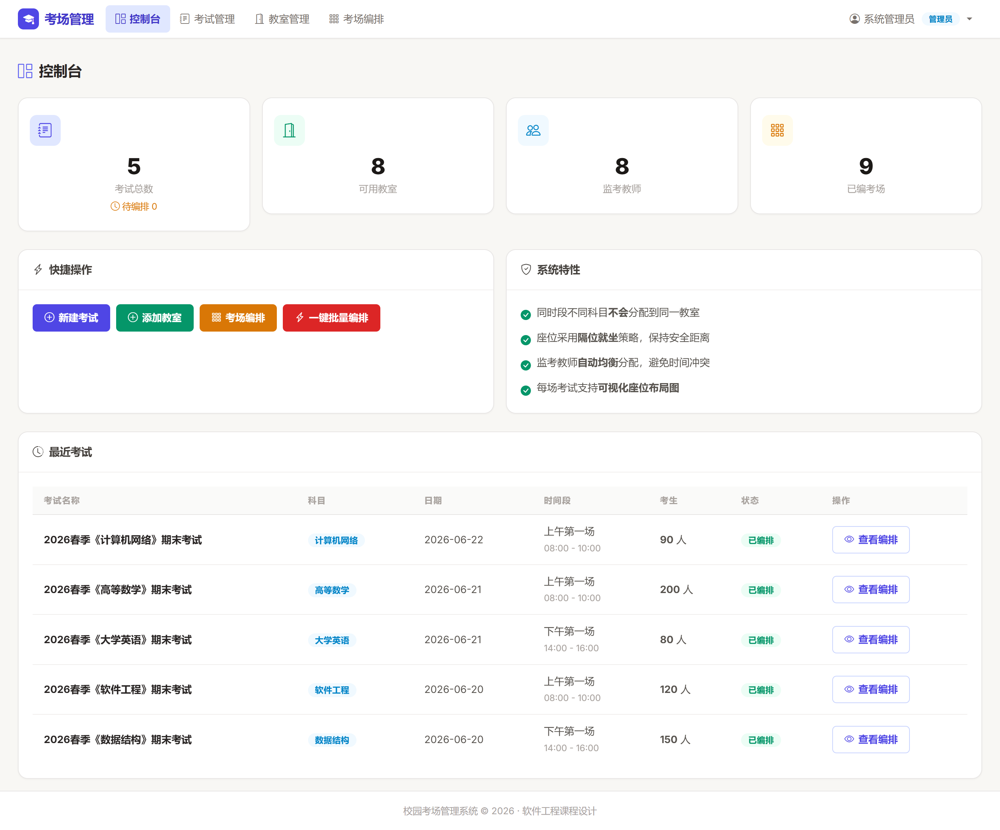
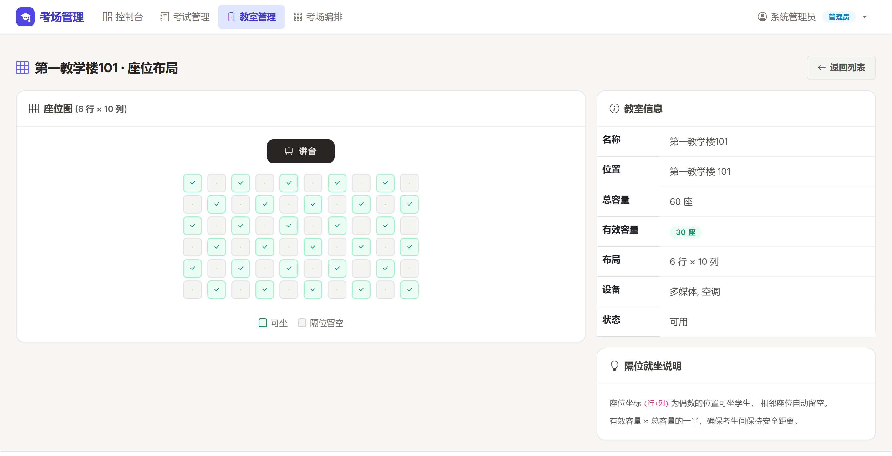
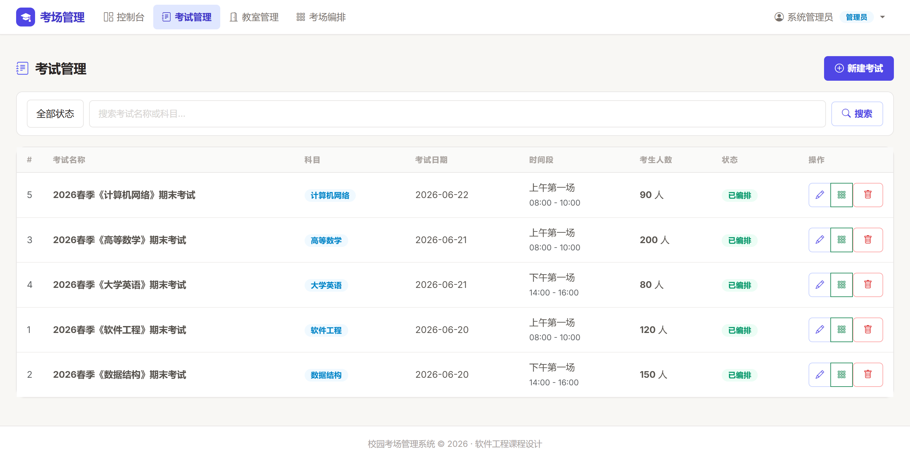
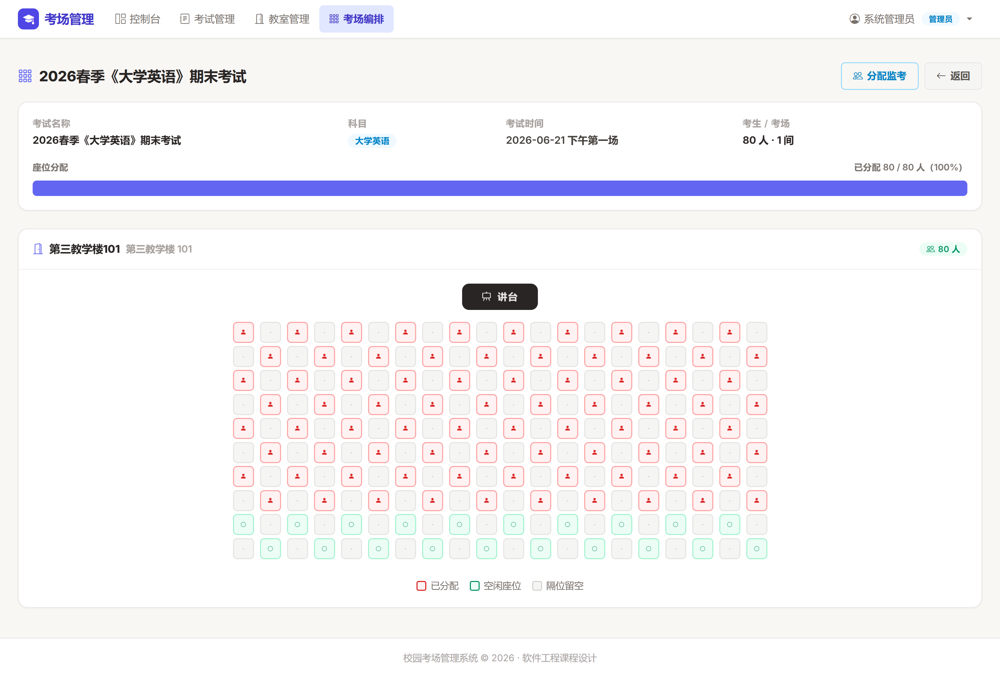
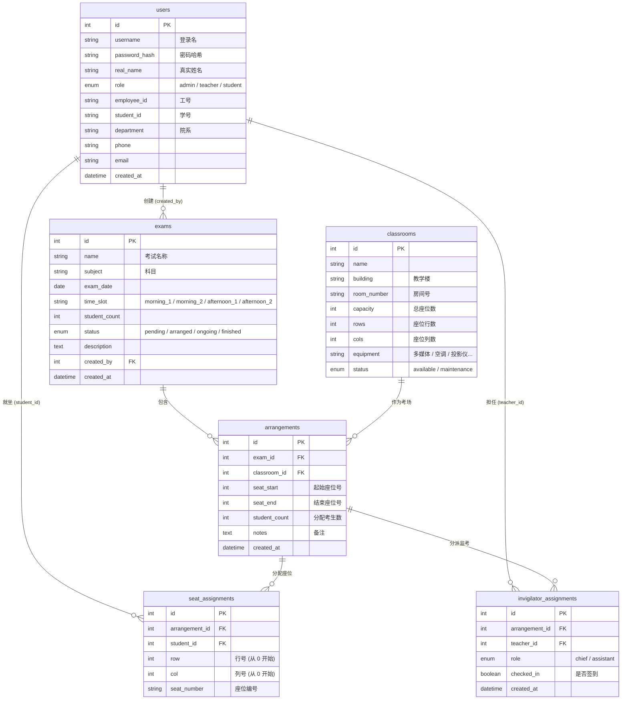

# 校园考场管理系统（Vibe Coding）

>**愿我的白昼与长夜不被剪碎，去拼凑一张无人观赏的拼图，愿我的双手不必被抵押，去浇灌一株不结果的树。愿那堵形式高墙，能放过一个只想安静安静学点东西的年轻人。**
>
>***—— 既然荒诞从不自行退场，那就让代码替我演完这场戏，让开源替后来的人省下那些本该属于他们的时间。***

> 软件工程课程设计 · 一键解决高校排考：自动编排考场、隔位就坐、负载均衡分监考

针对高校教务场景，替代人工 Excel 排考：自动避开教室冲突、按座位矩阵生成隔位就坐方案、按负载均衡分配监考教师，并提供直观的座位布局可视化。

## 1. 界面预览

系统主要页面一览（截图位于 `screenshots/` 目录）。

### 1. 首页


### 2. 控制台



### 3. 教室管理



### 4. 考试管理



### 5. 考场编排



## 2. 功能特性

**核心功能**

- **考场自动编排** — 输入考试科目 + 可用教室 + 考生人数，一键生成考场分配方案
- **隔位就坐** — 座位坐标矩阵 `(行+列)%2==0`，有效容量约为总容量一半
- **监考自动分配** — 负载均衡算法，避免同时间段冲突
- **座位布局可视化** — 每场考试支持交互式座位图

**管理功能**

- 考试管理（CRUD、状态流转）
- 教室管理（容量 / 设备 / 座位布局）
- 用户管理（管理员 / 教师 / 学生三角色）
- 一键批量编排

**硬约束**

| 约束 | 说明 |
|------|------|
| 教室互斥 | 同日期同时段的不同考试不会分配到同一教室 |
| 容量限制 | 每场考试分配座位数 ≤ 教室有效容量（隔位就坐） |
| 时间冲突 | 监考教师不会被分配到同一时段的多个考场 |

## 3. 技术栈

| 层 | 技术 |
|----|------|
| 后端 | Python 3.10+ + Flask 3.x |
| 数据库 | MySQL 8.x + SQLAlchemy 2.x |
| 前端 | HTML5 + Bootstrap 5 + Bootstrap Icons |
| 模板 | Jinja2 |
| 认证 | Flask-Login |

## 4. 快速开始

### 1. 环境要求

- Python 3.10+
- MySQL 8.x

### 2. 安装依赖

```bash
# 创建虚拟环境（如已有可跳过）
python -m venv .venv

# 激活虚拟环境
# Windows:
.venv\Scripts\activate
# macOS/Linux:
source .venv/bin/activate

# 安装依赖
pip install -r requirements.txt
```

### 3. 配置数据库

复制示例配置文件并修改为你的实际配置：

```bash
# 复制配置模板
cp app/config.example.py app/config.py
```

编辑 `app/config.py`，修改数据库连接字符串：

```python
SQLALCHEMY_DATABASE_URI = 'mysql+pymysql://用户名:密码@localhost:3306/campus_exam_system?charset=utf8mb4'
```

> **注意**: `app/config.py` 包含真实密码，已在 `.gitignore` 中排除，不会被提交到 Git。

### 4. 初始化数据库

```bash
python init_db.py
```

此脚本会自动：

- 创建 `campus_exam_system` 数据库
- 创建所有数据表
- 插入示例数据（1 管理员 + 8 教师 + 50 学生 + 10 教室 + 5 场考试）

### 5. 启动系统

```bash
python run.py
```

浏览器访问 **http://127.0.0.1:5000**

### 6. 测试账号

| 角色 | 用户名 | 密码 |
|------|--------|------|
| 管理员 | `admin` | `123456` |
| 教师 | `t01` ~ `t08` | `123456` |
| 学生 | `s001` ~ `s050` | `123456` |

## 5. 项目结构

```
校园考场管理系统/
├── app/
│   ├── __init__.py            # Flask 应用工厂
│   ├── config.py              # 配置（数据库 / 时间段）
│   ├── models/                # 数据模型层
│   │   ├── __init__.py        #   db + login_manager
│   │   ├── user.py            #   用户（admin / teacher / student）
│   │   ├── exam.py            #   考试
│   │   ├── classroom.py       #   教室（含隔位就坐算法）
│   │   └── arrangement.py     #   编排 / 座位 / 监考分配
│   ├── views/                 # 路由控制层
│   │   ├── auth.py            #   登录 / 注册 / 登出
│   │   ├── main.py            #   首页 / 控制台
│   │   ├── exam.py            #   考试 CRUD
│   │   ├── classroom.py       #   教室 CRUD
│   │   └── arrangement.py     #   考场编排 + 监考分配
│   ├── services/
│   │   └── arranger.py        # ★ 核心编排算法
│   ├── utils/
│   │   └── __init__.py        #   权限装饰器
│   ├── templates/             # 前端页面（Jinja2）
│   │   ├── base.html          #   基础布局
│   │   ├── index.html         #   首页
│   │   ├── dashboard.html     #   控制台
│   │   ├── login.html         #   登录
│   │   ├── register.html      #   注册
│   │   ├── exam/              #   考试相关页面
│   │   ├── classroom/         #   教室相关页面
│   │   └── arrangement/       #   编排相关页面
│   └── static/css/style.css   # 自定义样式
├── tests/                     # 单元测试
│   ├── test_arranger.py       #   编排服务测试
│   ├── test_routes.py         #   路由验证测试
│   └── test_ui_static.py      #   静态 UI 回归测试
├── screenshots/               # 系统界面截图（README 引用）
│   ├── 首页.png
│   ├── 控制台.png
│   ├── 教室管理.png
│   ├── 考试管理.png
│   └── 考场编排.png
├── run.py                     # 启动入口
├── init_db.py                 # 数据库初始化脚本
├── requirements.txt           # Python 依赖
└── README.md
```

## 6. 核心算法

### 1. 考场编排（`app/services/arranger.py`）

```
输入: 考试列表（科目 / 日期 / 时段 / 考生人数）+ 可用教室列表
输出: 考场-科目映射表 + 每场座位布局图

算法流程:
1. 查询同日期同时段已占用的教室 ID 集合
2. 可用教室按有效容量降序排列
3. 贪心分配: 依次取教室，直到容纳所有考生
4. 返回编排结果列表
```

### 2. 隔位就坐

```
座位矩阵: rows × cols
可坐条件: (row + col) % 2 == 0
有效容量: 约为总容量的一半

示例 (6×10 教室, 总容量 60, 有效容量 30):
  ✓ · ✓ · ✓ · ✓ · ✓ ·
  · ✓ · ✓ · ✓ · ✓ · ✓
  ✓ · ✓ · ✓ · ✓ · ✓ ·
  · ✓ · ✓ · ✓ · ✓ · ✓
  ✓ · ✓ · ✓ · ✓ · ✓ ·
  · ✓ · ✓ · ✓ · ✓ · ✓
```

### 3. 监考分配

```
1. 每个考场分配 1 名主监考
2. 容量 > 40 的教室额外分配 1 名副监考
3. 优先选择监考次数最少的教师
4. 避免同时间段冲突
```

## 7. 数据库设计



## 8. 运行测试

```bash
# 激活虚拟环境后运行所有测试
python -m unittest discover -s tests -v

# 运行单个测试文件
python -m unittest tests.test_arranger -v
python -m unittest tests.test_routes -v
python -m unittest tests.test_ui_static -v
```

测试覆盖：

- **编排服务**：教室冲突检测、重复编排防护、批量编排隔离、监考冲突检测
- **路由验证**：表单输入校验、权限控制、删除保护
- **静态 UI**：CSS 变量完整性、表单原生校验、座位图滚动容器、状态徽章一致性

## 9. 使用流程

```
1. 管理员登录 (admin / 123456)
2. 添加教室 → 设置容量 / 行列数 / 设备
3. 创建考试 → 设置科目 / 日期 / 时段 / 考生人数
4. 考场编排 → 选择考试 → 自动编排
5. 分配监考 → 自动分配监考教师
6. 查看结果 → 座位布局图 + 考场映射表
```
