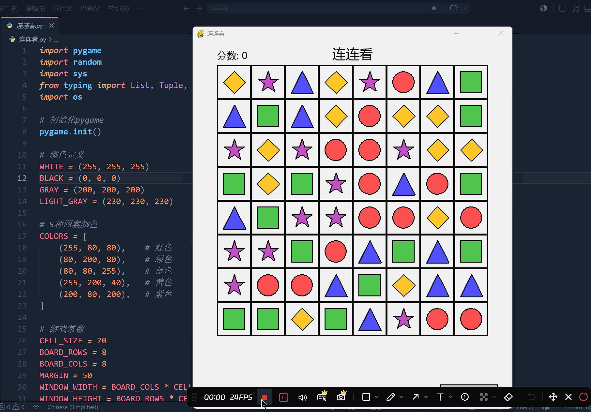

# 连连看游戏（Vibe Coding）

一个使用 Python 和 Pygame 制作的经典连连看小游戏。

>一个帮别人做的一个大学 Python 结课大作业。

## 运行效果



## 环境要求

- Python 3.8+
- Pygame 2.6+

## 项目结构

```
连连看/
├── 连连看.py        # 游戏主程序
├── 运行效果.gif      # 运行效果演示
├── requirements.txt # Python 依赖
├── README.md        # 项目说明
└── .gitignore       # Git 忽略配置
```

## 运行

```bash
# 创建虚拟环境（可选）
python -m venv .venv
.venv\Scripts\activate

# 安装依赖
pip install -r requirements.txt

# 运行游戏
python 连连看.py
```

## 游戏玩法

1. 点击两个相同图案进行消除
2. 两个图案之间的连接线 **不能超过两个转弯**
3. 连接线可以延伸到棋盘外（U 形连接）
4. 消除所有图案即可获胜
5. 点击「重新开始」按钮可以重新开始游戏

## 图案说明

游戏共有 5 种图案，每种图案由颜色和形状组合而成：

| 颜色 | 形状 |
|------|------|
| 🔴 红色 | 圆形 |
| 🟢 绿色 | 方形 |
| 🔵 蓝色 | 三角形 |
| 🟡 黄色 | 菱形 |
| 🟣 紫色 | 五角星 |
